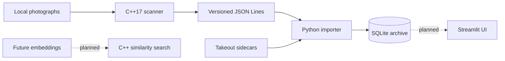

# DinnDex

**Your dinner history, indexed.**

A local, privacy-conscious dinner photo archive inspired by four years of daily
photographs. C++ handles file scanning, metadata, and content hashing; Python
reconciles dates and maintains SQLite records. No photos leave your computer.

**Status: Milestone 1 — working local archive.** Import a directory today and get
persistent, deduplicated photo and meal records. The gallery, manual-editing UI,
analytics, optional AI, and visual search belong to later milestones and are not
implemented. There are no screenshots yet because there is no UI in this milestone.

## What works

- Recursive JPG/JPEG, PNG, and WebP inventory, including uppercase extensions.
- Streaming SHA-256 hashing with OpenSSL; exact duplicate detection independent of names.
- Exiv2 dimensions and EXIF timestamps, with timezone offsets preserved when present.
- Google Takeout sidecars, including supplemental metadata, moved copy counters,
  and truncated sidecar names matched by their `title`.
- Documented date precedence with all candidates retained as provenance.
- Transactional, incremental SQLite imports; duplicate content has one photo and
  multiple source paths. Reimports preserve existing dates and meal fields.
- Corrupt/unreadable files reported while valid files continue; symlinks skipped.
- Versioned JSON Lines interface usable independently of Python.

HEIC is currently unsupported and counted among skipped files. Export/convert a
copy to JPEG before importing. Originals are never renamed, modified, or deleted.
Exiv2 validates image headers/metadata, not full pixel decoding: this is not an
image-repair or exhaustive integrity-checking tool.

## Install (Ubuntu 24.04)

```bash
sudo apt update
sudo apt install g++ cmake make libssl-dev libexiv2-dev nlohmann-json3-dev python3-venv
python3 -m venv .venv
source .venv/bin/activate
python -m pip install -e '.[test]'
cmake -S . -B build -DCMAKE_BUILD_TYPE=Release
cmake --build build --parallel 2
ctest --test-dir build --output-on-failure
python -m pytest -q
```

C++17 and Python 3.10+ are required. Runtime Python uses only the standard library;
pytest and Pillow are test-only dependencies. No ML framework, API key, cloud
service, or model download is needed. System packages provide Exiv2, OpenSSL, and
nlohmann JSON; the build does not fetch dependencies from the internet.

For a non-system dependency prefix, pass `-DCMAKE_PREFIX_PATH=/path/to/prefix`
when configuring. In the current managed cloud environment, use the installed
virtual environment and
`-DCMAKE_PREFIX_PATH=/workspace/dinndex-tools/sysroot/usr`. Ubuntu commands above
are documented but were not executed on Ubuntu in this Debian-based cloud machine.

## Use

Run these commands from the repository root after building:

```bash
# SOURCE can be anywhere, including paths with spaces or Unicode.
python -m dinndex init --db data/dinndex.sqlite3
python -m dinndex import --source '/path/to/dinner photos' --db data/dinndex.sqlite3
python -m dinndex stats --db data/dinndex.sqlite3

# Inspect the engine independently; output's parent must exist.
mkdir -p output
./build/dinndex scan '/path/to/dinner photos' --output output/manifest.jsonl
./build/dinndex --help
python -m dinndex import --help
```

Use `--engine /absolute/path/to/dinndex` or `DINNDEX_ENGINE` to select a different
engine. `--db` selects a local SQLite database; the default is
`data/dinndex.sqlite3`. The database and its parent directory are created as needed.
An existing manifest is deliberately never overwritten: choose a new output path.

The importer prints JSON with `new`, `known`, `failed`, warnings, and the scanner
summary (including skipped files and duplicates within that scan). `known` counts
valid source files whose content was already inserted, including duplicates within
the same import. No duplicate originals are removed. Progress is sent to stderr
every 100 files. Exit codes: **0** success, **1** fatal error, **2** partial scan
with failed files; Python returns **130** on keyboard interruption. Inspect warnings
even after a successful import: malformed sidecars leave usable photos undated.

Each new content hash creates one meal, even when two photos share a date. This
avoids assuming one dinner per day. Grouping/editing meals will arrive in Milestone 2.
The `stats` command currently reports record counts only, not the future analytics.

An interrupted or failed import can leave successfully committed photos in the
database. Simply repeat the command to resume. Keep the database on a local
filesystem and back it up along with its WAL if copying while it is open.

## Dates and provenance

Precedence is **EXIF original → Takeout photoTakenTime → EXIF digitized → EXIF
modified → recognizable filename → optional filesystem mtime**. Filesystem mtime
is disabled unless you explicitly pass `--use-mtime`. Without a valid source,
a photo is undated. EXIF original and Takeout dates are high confidence, other
embedded dates medium, filename and filesystem dates low.

Naive EXIF/filename dates stay naive; Takeout epoch seconds become offset-aware
UTC. A date-only filename stays a date, rather than inventing a time. Meals use
the calendar date of the chosen value, without UTC conversion of local EXIF dates.
Conflicting candidates, original sidecars, and warnings are retained in each
source's metadata. Ambiguous sidecars are reported rather than guessed. We do not
use Takeout `creationTime` as a capture date. Reimport updates observations but
never silently changes an existing chosen date, meal name, description, or notes.
This conservative policy means newly supplied sidecars do not automatically fix
previously imported dates; a later explicit reconciliation/editing workflow is needed.

## Architecture



- `cpp/`: independently testable engine and reusable core library.
- `dinndex/`: CLI, subprocess orchestration, date reconciliation, database access.
- `dinndex/migrations/`: packaged, ordered SQL migrations using `PRAGMA user_version`.
- `tests/`, `cpp/tests/`: synthetic fixtures and unit/integration tests.
- [Architecture and interface contract](docs/architecture.md): schema, failure behavior,
  algorithm trade-offs, and extension points.

C++ demonstrates filesystem traversal, bounded-buffer hashing, and hash-table
lookup today; vector search will extend the engine without Python bindings.
Scanning takes O(total bytes + files) expected time and O(unique hashes + directory
depth) working memory, excluding directory enumeration internals. Python streams
records and caches sidecar indexes per directory; metadata storage scales with the
number and size of sidecars. No performance benchmarks or speedups are claimed.

## Testing and troubleshooting

Tests generate synthetic images in temporary directories; no personal photos or
invented personal records are included. They exercise real C++ → Python → SQLite
imports, duplicate contents/paths, reimports, edits, dates, constraints, corruption,
permissions, symlink loops, interruption recovery, and CLI exit behavior.

- Missing Exiv2/OpenSSL/JSON: install the development packages above, then rerun CMake.
- Missing engine: build first, or pass `--engine`; running Python alone does not build C++.
- Metadata error: inspect warnings; keep the original and try a fresh exported copy.
- Permission error: make the source readable; the importer continues with other files.
- No date: supply a matching Takeout sidecar before first import, or opt in to mtime
  only if you understand that it is not necessarily the capture time.
- Database from a newer version: use a matching DinnDex version; never downgrade
  `user_version` manually. Back up before applying new schema migrations.

## Privacy and roadmap

Keep originals outside the checkout or under ignored `data/`. `output/`, databases,
virtual environments, common image extensions, and secrets are ignored. Review
`git status` before committing; ignore rules are a guardrail, not a privacy guarantee.
Stored provenance may include private sidecar fields, including location data; do
not publish your database or manifests. There is no UI or network upload code.

Next: Streamlit timeline, gallery, manual editing and thumbnails (Milestone 2),
then analytics/annual recap (3), opt-in AI with review/caching (4), and local
embeddings plus measured C++ similarity search (5). Advanced indexing and mosaics
are optional later work. These future features are deliberately absent here.
